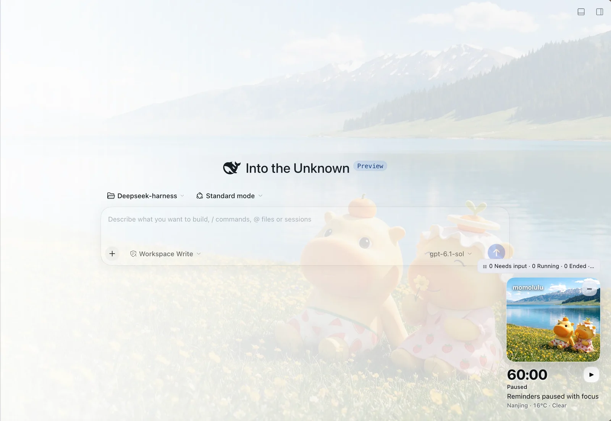

# momolulu

A gentle companion for DeepSeek Harness (DSH): scenic photos, a focus timer, wellbeing reminders, weather, and a cross-session radar.

[中文](README.md) | **English**

[](https://www.npmjs.com/package/momolulu)
[](https://www.npmjs.com/package/momolulu)
[](LICENSE)
[](https://github.com/YinniCoding/momolulu/actions/workflows/publish.yml)

```sh
dsh plugin --profile web add momolulu
```



## Features

- **Photo companion**: a floating photo card with subtle drift and breathing motion; collapse it to an avatar with a progress ring and countdown.
- **Focus timer**: 15 / 25 / 45 / 60 minutes, with pause, resume and reset. Starting focus requests fullscreen; Esc exits fullscreen without interrupting the timer.
- **Break reminders**: every 20 minutes by default, a gentle nudge for water and a stretch. The floating widget shakes briefly and the reminder row highlights; choose "Got it" or "Remind in 10 min". An 8-second preview is available.
- **Session radar**: lists ordinary conversations that are running, ended-but-unread, waiting for input, or requesting permission. Click a row to open it. It never switches conversations automatically, answers questions, or grants permissions.
- **Weather**: Nanjing by default, via Open-Meteo. Location is requested only after you click "Use my location".
- **Reading protection**: reduces background distraction over the chat area while keeping the scenery on the right. Background brightness and opacity are adjustable.
- Chinese and English UI copy, with support for the system's reduced-motion setting.

## Install

Built for **DSH 0.2.1-rc.5 through 0.2.x**; verified mainly on 0.2.2-rc.1, earlier 0.2.x releases are untested.

Published on npm. Install it in one line (replace `web` with your profile name):

```sh
dsh plugin --profile web add momolulu
```

Desktop builds can also use **Plugins → Add plugin** and enter `momolulu`.

To pin a version, use the commit-pinned Git specification from the GitHub release notes; you can also clone this repository and hand its absolute directory to DSH's plugin manager. **No separate web server is needed.**

> **Already using the older local package?** Disable or uninstall `@local/lumululu-mei` before enabling `momolulu`; both render the same companion. The browser storage key `llm.companion.v2` is unchanged, so preferences and timer data continue on the same page origin. Back up first if you may need to roll back.

### Install from npm

```sh
npm install -g momolulu
```

Useful if you manage global packages yourself; inside DSH, prefer `dsh plugin add` above.

### Add the Discover index

If your DSH profile has the optional plugin-market Discover feature enabled, add this self-hosted index source:

```
https://raw.githubusercontent.com/YinniCoding/momolulu/main/market.json
```

This is a **maintainer-hosted index**, not a claim of inclusion in a central or official marketplace. The index pins a release commit; the package is not published to npm.

## Use

- Click the photo to open the focus panel. The control beside the countdown starts or pauses without opening the panel.
- Click `−` to minimize to an avatar; click the avatar to bring the photo back.
- Open **Reminder settings → Test reminder (8 sec)** to preview the shake and highlight without changing real reminder times.
- Click the radar summary or the avatar badge to inspect other conversations; click a row to open it.
- Open **Appearance** to switch scene and motion, toggle reading protection, and adjust background brightness and opacity.
- Pausing, finishing a session, or unloading the plugin never forces fullscreen to exit; only Esc or "Exit fullscreen" does.

## Privacy

See [PRIVACY.md](PRIVACY.md). The plugin has no developer backend and no plugin analytics. Weather makes third-party requests; preferences and timer data stay in browser storage; location is optional.

## FAQ

**Why do momolulu and lumululu-mei conflict?**
They are two versions of the same plugin and would render the same companion twice. Disable or uninstall `@local/lumululu-mei` before enabling `momolulu`.

**Why is the weather city Nanjing by default?**
The default coordinates are Nanjing (32.06, 118.80). Location is requested only after you click "Use my location", and a page refresh returns to Nanjing.

**Why does starting focus request fullscreen?**
It is an optional bit of ceremony. A denied fullscreen request does not affect the timer, and Esc exits fullscreen without stopping it.

**Which DSH versions are supported?**
Declared support: `>=0.2.1-rc.5 <0.3.0`; verified mainly on `0.2.2-rc.1`.

**Where is my data stored?**
Preferences and timer state live in browser `localStorage` under `llm.companion.v2` and are never uploaded. The session radar only reads local DSH state.

**How do I uninstall?**
Remove `momolulu` through the DSH plugin manager. To also clear preferences, delete that localStorage key manually.

## Known limitations

- The radar lists ordinary conversations only, not child-agent conversations. "Ended" does not imply successful execution, and the unread state is page-local and may be lost on refresh.
- Focus timer state is not shared between multiple windows.
- The browser or Electron may deny fullscreen or location. Such failures do not prevent focus timing.
- Timers and reminders are not OS alarms: closing DSH or suspending the device prevents timely delivery, and the countdown catches up when ticks resume.
- The default weather city is Nanjing. Located coordinates are rounded to two decimal places and held only in memory.
- Automated tests cover clock logic, radar classification and reminder decisions, and fullscreen control (with an injected test port). Cross-platform visual layout, real fullscreen, session navigation and permission events still require manual verification.
- There is no built-in updater. Upgrade by uninstalling and reinstalling through the DSH plugin manager's supported flow.

## Development

Local checks need Node.js 20 or newer; there is no build step and no install script.

```sh
npm run check
npm test
npm pack --dry-run
```

## License

- **Source code**: [MIT](LICENSE).
- **Artwork** (the three scenic photos, icon and screenshot): [CC BY 4.0](LICENSE-ARTWORK.md); attribute as "momolulu artwork © 2026 YinniCoding, CC BY 4.0".

Weather data: [Open-Meteo](https://open-meteo.com/) (CC BY 4.0). No affiliation with DeepSeek or the character-rights owners is implied; see [NOTICE.md](NOTICE.md).
